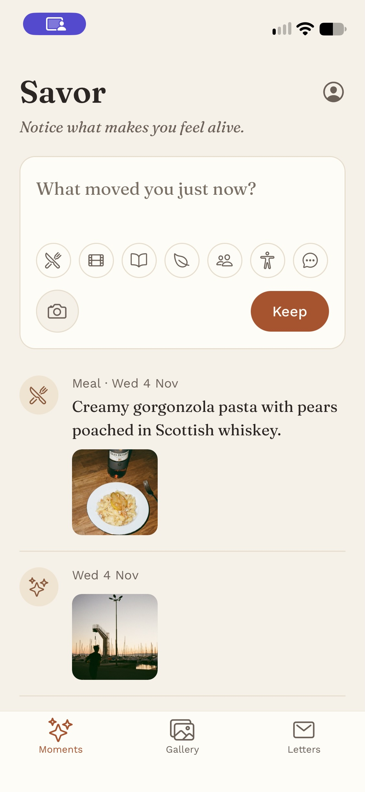
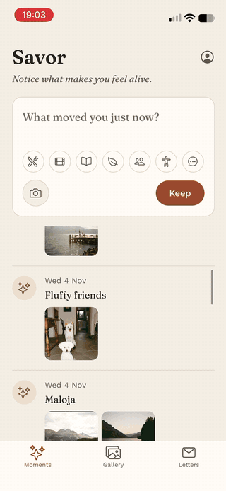
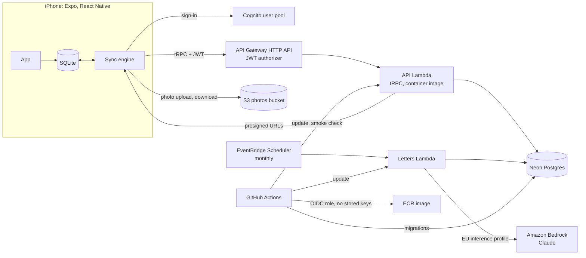

# Savor

A private iPhone journal for keeping small moments and looking back at them, with a monthly letter written from your own words by AI.

<p>
  
  
  
  
</p>

## Why it exists

Savor started from a simple idea: a space that works differently from Instagram. Social media asks for a polished version of your day, and the likes and comments that follow make you feel like you need to perform, living your life for someone else instead of for yourself.

Savor is the opposite. It's a private place to keep the moments that are just yours, like a meal with a friend, fog over a lake, or a song sung badly on the phone, and to look back at them later. It isn’t a social network. Nothing is posted, nobody reacts, and it never measures you: no streaks, no counts, no missed days. Once a month it gathers what you kept into a short letter, without judging any of it.

## Architecture



- **The phone is the source of truth.** A moment is saved to SQLite on the phone first, so keeping one never waits for the network ([ADR 0005](docs/adr/0005-local-first-sync.md)). In the background, the sync engine pushes local changes and pulls everything newer than the last version it saw. The server gives each change a per-user version, keeps deletes as tombstones, and lets the edit that reaches it last win, so a stale edit can't bring back a deleted moment. This is tested on Postgres ([sync tests](apps/api/src/sync/sync.test.ts#L160)) and with two simulated devices ([two-device tests](apps/mobile/src/__tests__/sync-two-devices.test.ts#L149)). Photo records sync with their moments; the files follow separately, and other devices show a placeholder until a file arrives.
- **Every call carries a Cognito token.** API Gateway's JWT authorizer rejects calls without a valid one before the Lambda runs, and the API takes the user only from the token's `sub` ([spec 004](specs/004-auth-and-deploy.md)).
- **The API is one tRPC router** in a Lambda container image, on Neon Postgres. Zod schemas are shared with the phone through `packages/shared`.
- **Photos go straight between the phone and a private S3 bucket**, through short-lived presigned URLs that the API signs. The API never handles the bytes ([spec 006](specs/006-photo-uploads.md)).
- **Once a month, a second Lambda writes letters.** It's started by EventBridge Scheduler on the 1st to 3rd at 08:00 Zurich time. It reads each opted-in person's moments for the month and asks Claude on Bedrock, through the EU inference profile, for a short letter ([spec 007](specs/007-monthly-letter.md), [ADR 0007](docs/adr/0007-llm-provider-and-data.md)).
- **CI deploys through an OIDC role**, with no AWS keys stored in GitHub. A push to `main` that changes the API builds the image, runs the migrations, updates both functions and smoke-checks the API. All infrastructure is Terraform.

Deploying and operating it: [docs/operations.md](docs/operations.md).

## Engineering highlights

- **One person's data never reaches another.** A push that touches another user's row is rejected whole, and pulls are filtered by the token's user. Tested in [`sync.test.ts`](apps/api/src/sync/sync.test.ts#L214), and checked against the deployed API by the [smoke test](apps/api/scripts/smoke.ts) ([spec 004, verified criteria](specs/004-auth-and-deploy.md#L87)).
- **Photos leave the phone without their location.** The phone uploads a re-encoded copy, at most 2048 px ([test](apps/mobile/src/__tests__/photo-transfer.test.ts#L14)). The upload form allows exactly one JPEG of up to 10 MB, at one key, for 5 minutes ([test](apps/api/src/photos/s3-storage.test.ts#L28)). Real uploaded objects were checked with exiftool: no GPS or EXIF tags ([spec 006](specs/006-photo-uploads.md#L93)).
- **An LLM feature with guardrails.** The model gets only the month's dates, kinds and words, escaped inside delimiters, and a test pins the [exact request](apps/api/src/letters/prompt.test.ts#L29). Before a reply is saved, it's [checked](apps/api/src/letters/prompt.test.ts#L221) for refusals, truncation, length and leaked delimiters. The job waits until the month has ended in the person's time zone, never sends deleted or other people's moments, and never writes a letter twice ([job tests](apps/api/src/letters/job.test.ts#L197)). Mutation checks confirmed that removing the user or deleted-moment filter fails a test.
- **No keys to leak.** GitHub deploys with a short-lived OIDC role ([`github.tf`](infra/bootstrap/github.tf)). The letters Lambda calls Bedrock with its own IAM role, allowed only the EU profile and its models ([`letters.tf`](infra/app/letters.tf#L70)). The IAM policy simulator confirmed that the global profile, and the API's role, are denied.
- **Deploys that fail safe.** Every push runs typecheck, lint, format, about 500 tests (the API's against real Postgres), an iOS export and `terraform validate`. A deploy runs the migrations before it updates the functions, so a failing migration leaves the previous image running. This was checked with a deliberately failing migration ([spec 004](specs/004-auth-and-deploy.md#L95), [workflow](.github/workflows/ci.yml#L140)).

## How it's built

Spec-driven. Every feature starts as a spec with acceptance criteria, ticked off as they pass; since spec 004, each one also says how it was verified. Larger decisions are ADRs.

| Spec                                            | Feature                            |
| ----------------------------------------------- | ---------------------------------- |
| [001](specs/001-moment-kinds.md)                | Moment kinds                       |
| [002](specs/002-local-sqlite.md)                | Moments in a local SQLite database |
| [003](specs/003-shared-schemas-and-sync-api.md) | Shared schemas and the sync API    |
| [004](specs/004-auth-and-deploy.md)             | Auth and deployment on AWS         |
| [005](specs/005-sign-in-and-sync.md)            | Sign-in and moment sync            |
| [006](specs/006-photo-uploads.md)               | Photo uploads                      |
| [007](specs/007-monthly-letter.md)              | The monthly letter                 |

| ADR                                                   | Decision                                |
| ----------------------------------------------------- | --------------------------------------- |
| [0001](docs/adr/0001-monorepo-with-pnpm.md)           | Monorepo with pnpm workspaces           |
| [0002](docs/adr/0002-api-hosting-lambda-container.md) | API on AWS Lambda, as a container image |
| [0003](docs/adr/0003-database-postgres.md)            | Postgres as the server database         |
| [0004](docs/adr/0004-auth-cognito.md)                 | Authentication with Amazon Cognito      |
| [0005](docs/adr/0005-local-first-sync.md)             | Local-first sync                        |
| [0006](docs/adr/0006-development-build.md)            | A development build instead of Expo Go  |
| [0007](docs/adr/0007-llm-provider-and-data.md)        | LLM provider and what data it sees      |

Built with [Claude Code](https://claude.com/claude-code) as a pair programmer. I write the specs and ADRs, review every plan before code changes, and do the manual checks against AWS and on devices. Claude Code implements each approved plan against the spec's acceptance criteria, tests first where practical, in small conventional commits.

```
apps/mobile      Expo app
apps/api         tRPC API and the letters job
packages/shared  Zod schemas and types shared by both
infra/           Terraform: bootstrap (state, deploy role, budget) and app
specs/           one spec per feature
docs/adr/        architecture decisions
```

## Tech stack

| Area           | Tools                                                                                                          |
| -------------- | -------------------------------------------------------------------------------------------------------------- |
| Mobile         | Expo 58, React Native 0.88, Expo Router, TypeScript, expo-sqlite with Drizzle, Amplify Auth                    |
| API            | Node 24, tRPC 11, Drizzle, Zod 4, esbuild                                                                      |
| Data           | Neon Postgres; Postgres 17 in Docker locally; S3 for photos                                                    |
| AWS            | Lambda (arm64 container image), API Gateway HTTP API, Cognito, EventBridge Scheduler, Secrets Manager, Bedrock |
| Infrastructure | Terraform 1.16                                                                                                 |
| CI/CD          | GitHub Actions with OIDC                                                                                       |
| Tests          | Vitest (API on Postgres, shared), Jest with React Native Testing Library (app)                                 |

## Running locally

You need Node 24 (`nvm use` reads `.nvmrc`), pnpm through corepack, Docker, and Xcode with an iOS simulator.

```
pnpm install
```

**App.** It runs as a development build rather than in Expo Go, because Amplify Auth needs its own native module ([ADR 0006](docs/adr/0006-development-build.md)). `ios/` is generated and gitignored; native settings live in `apps/mobile/app.json`.

1. Point the app at the deployed API and user pool. The values are the Terraform outputs `api_url`, `user_pool_id` and `client_id`; none of them is a secret.

   ```
   cp apps/mobile/.env.example apps/mobile/.env
   ```

2. Build and install it on a simulator. This takes a few minutes the first time:

   ```
   pnpm --filter @savor/mobile exec expo run:ios
   ```

3. After that, `pnpm mobile` serves the JavaScript with fast refresh. Build again only after adding a native package or changing `app.json`.

To try two devices, install the build on a second simulator with `expo run:ios --device "<simulator name>"` and sign in with the same account on both. On an iPhone, `expo run:ios --device` needs a signing team in Xcode. With a free Apple ID, the app stops opening after 7 days.

**API.** It runs locally against Postgres 17 in Docker, on port 5433:

```
docker compose up -d
pnpm --filter @savor/api dev
```

The dev server applies the migrations and serves tRPC on `http://localhost:3000`. Locally, a development-only `x-dev-user-id` header stands in for the signed-in user; in AWS it's ignored.

```
curl http://localhost:3000/health.check
curl -G http://localhost:3000/sync.pull -H 'x-dev-user-id: ana' \
  --data-urlencode 'input={"sinceVersion":0}'
```

## Tests

```
pnpm typecheck && pnpm lint && pnpm format:check && pnpm test
```

`pnpm test` runs about 500 tests: the shared schemas, the API against the `savor_test` database (so Postgres must be running), and the app with Jest. CI runs the same, plus an iOS export and `terraform validate`. Checks against the deployed system, such as the smoke test, the photo checks and `letter-preview`, are in [docs/operations.md](docs/operations.md).

Code and docs are formatted with Prettier: `pnpm format`. To have `git blame` skip the commit that first formatted the repo, run `git config blame.ignoreRevsFile .git-blame-ignore-revs` once.

## Roadmap

- [x] Core app: keep moments with photos, timeline, gallery, full-screen viewer, edit, delete
- [x] M0: monorepo, CI, specs
- [x] M1: moment kinds (first spec-driven feature)
- [x] M2: backend and sync
  - [x] Local SQLite store with UUIDs and tombstones (spec 002)
  - [x] Shared schemas and local API (spec 003)
  - [x] Auth and deployment on AWS (spec 004)
  - [x] Sign-in and moment sync (spec 005)
  - [x] Photo uploads (spec 006)
- [x] M3: monthly letter (LLM API, scheduled)
- [ ] M4: enrichment agent (SQS, tools)
- [ ] M5: TestFlight via CI, demo video
- [ ] M6: ask your moments (RAG, optional)
